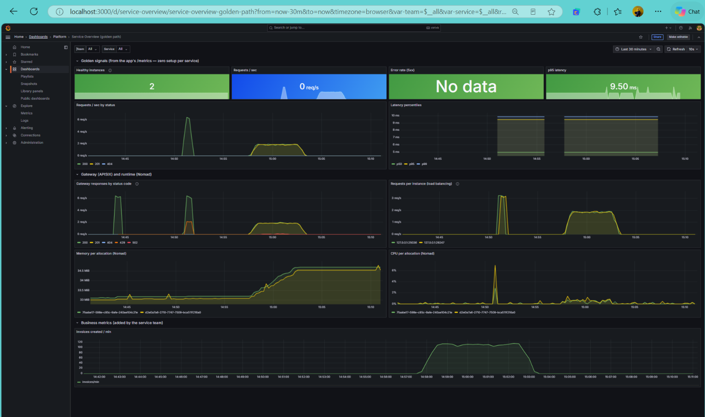
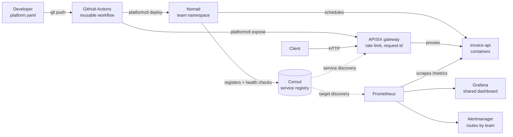
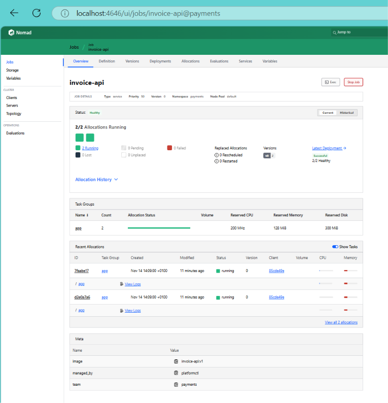
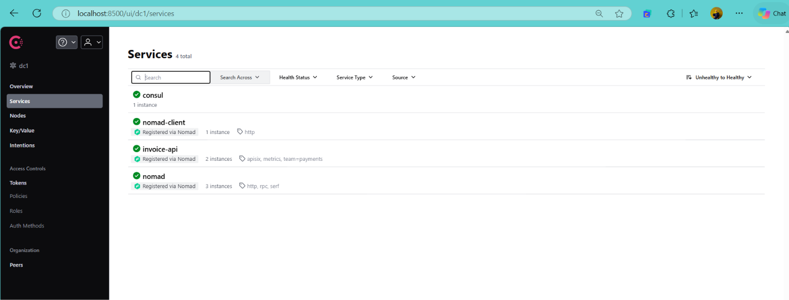
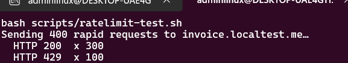
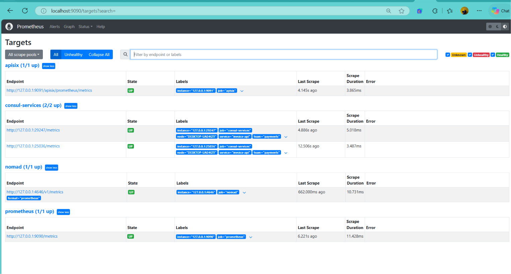
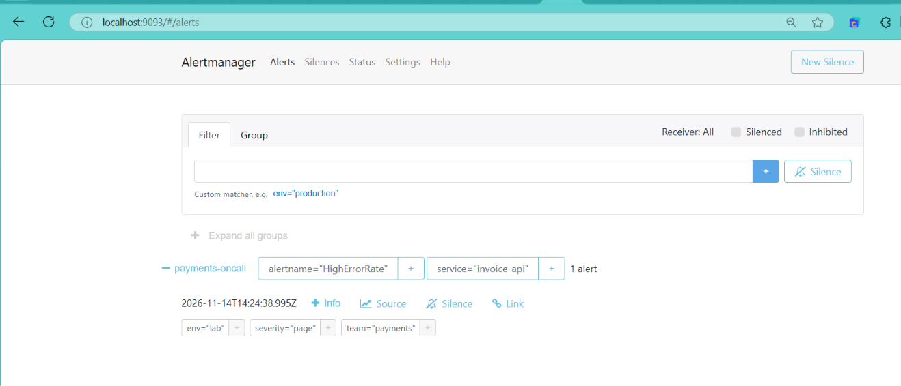
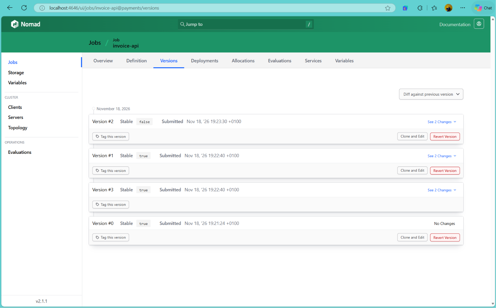
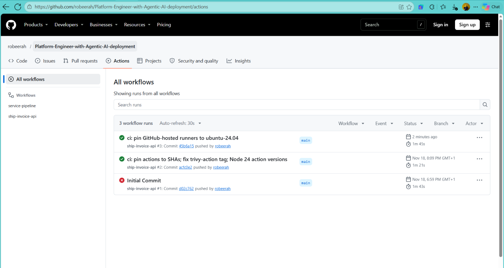
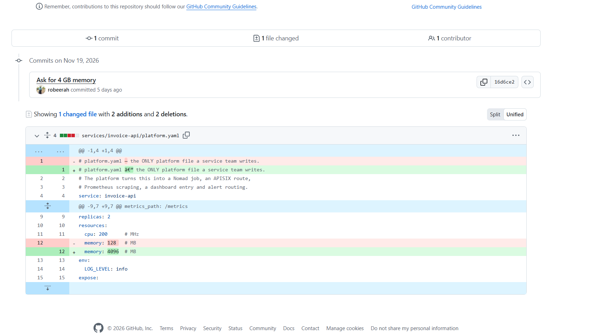

# Self-Service Developer Platform Lab

**A working internal developer platform built on Nomad, Consul, APISIX, Prometheus, Grafana and GitHub Actions.** A developer writes one 20-line `platform.yaml`, and the platform deploys, routes, rate-limits, monitors and alerts on their service. No tickets, no hand-written infrastructure config.




---

## The problem

In many teams, shipping a new service means a chain of requests to the platform team: someone writes the scheduler job, someone wires up CI, someone adds a gateway route and TLS, and monitoring is often forgotten. Each service waits days, and the platform team becomes the bottleneck.

## The solution: one golden path

```yaml
# services/invoice-api/platform.yaml — the only platform file a team writes
service: invoice-api
team: payments
port: 8080
health_path: /healthz
replicas: 2
resources: { cpu: 200, memory: 128 }
expose:
  host: invoice.localtest.me
  rate_limit: { requests: 300, per_seconds: 60 }
```

From that file the platform:

| Capability | How | Developer effort |
| --- | --- | --- |
| **Deploy** | `platformctl` renders a Nomad job from a platform-owned template, into the team's namespace, with rolling updates and auto-revert | 0 lines of HCL |
| **Discover** | Nomad registers every instance in Consul with health checks and `team` tags | none |
| **Expose** | An APISIX route is created through the Admin API; upstreams resolve through Consul, so scaling needs no gateway change | none |
| **Protect** | Per-client rate limiting, request IDs, guardrails on CPU/memory/replicas/hostnames | pick a tier |
| **Observe** | Prometheus discovers targets from Consul; one shared Grafana dashboard covers every service | expose `/metrics` |
| **Alert** | Baseline alert rules; Alertmanager routes by the `team` label to that team's receiver | none |
| **CI/CD** | Reusable GitHub Actions workflow: validate → test → build → scan → smoke test on an ephemeral Nomad cluster → deploy | 15-line caller |

## Architecture



**Key design idea:** Consul is the glue. Because every service registers itself with standard tags, the gateway and monitoring discover new services on their own. The platform team owns templates and guardrails, never individual services.

## What it looks like

| | |
| --- | --- |
|  **Nomad:** job deployed into the team namespace |  **Consul:** healthy instances with ownership tags |
|  **APISIX:** rate limiter returning 429s |  **Prometheus:** targets auto-discovered with `team` labels |
|  **Alerting:** incident routed to the owning team |  **Safe deploys:** bad release rolled back automatically |
|  **CI/CD:** reusable pipeline run |  **Guardrails:** PR blocked for exceeding memory cap |

## Quick start

Requirements: Ubuntu 22.04/24.04 (native, VM or WSL2) with Docker Engine. See [docs/WALKTHROUGH.md](docs/WALKTHROUGH.md) for the full guided lab.

```bash
bash scripts/install-tools.sh     # Docker, Nomad, helpers (one time)
make up                           # Consul, APISIX, Prometheus, Alertmanager, Grafana
make nomad                        # second terminal: Nomad dev agent

make onboard TEAM=payments        # platform team: create the team's namespace
make build deploy expose          # developer: ship invoice-api
make status
curl -H "Host: invoice.localtest.me" http://127.0.0.1:9080/
make urls                         # all the UIs
```

Drills: `make load` (traffic), `make ratelimit` (429s), `make break` / `make fix` (incident), `make bad-release` (auto-revert).

## Repository map

```
.github/workflows/
  service-pipeline.yml     # platform-owned reusable pipeline (workflow_call)
  ship-invoice-api.yml     # what a service team adds (15 lines)
platform/
  platformctl.py           # self-service CLI: validate, render, deploy, expose, status, onboard
  templates/service.nomad.hcl.tpl   # the golden-path Nomad job template
  teams.yaml               # single source of truth for teams and guardrails
infra/
  docker-compose.yml       # shared platform services
  apisix/config.yaml       # gateway with Consul discovery
  nomad/agent.hcl          # Prometheus telemetry for Nomad
  prometheus/              # Consul service discovery + baseline alert rules
  alertmanager/            # team-based alert routing
  grafana/                 # provisioned datasource + shared dashboard (as code)
services/invoice-api/      # sample service following the platform contract
scripts/                   # installers, load, chaos and rate-limit drills
docs/WALKTHROUGH.md        # step-by-step lab with real-life scenarios
```

## Self-service vs platform-managed

| Developers do themselves | Platform team owns |
| --- | --- |
| Image, port, replicas, CPU/memory within caps | Nomad/Consul clusters, namespaces, the job template |
| Deploy, scale, roll back their service | Reusable pipeline, runners, scanning policy |
| Hostname, rate-limit tier | Gateway, TLS, global plugins, Admin API keys |
| `/metrics`, custom dashboards, alert channel | Prometheus, Grafana, alert rules, routing tree |

## What I'd add for production

- Nomad and Consul ACLs, with GitHub OIDC → Nomad JWT auth so CI gets short-lived, namespace-scoped tokens
- TLS with a wildcard certificate and automated DNS-01 renewal
- Declarative gateway config with ADC instead of direct Admin API calls
- Vault or Nomad Variables for secrets
- Logs (Loki) and traces (OpenTelemetry) alongside metrics
- Multi-node clusters with HA for Consul, Nomad servers and APISIX

## Tech

Nomad · Consul · Apache APISIX · etcd · Prometheus · Alertmanager · Grafana · GitHub Actions · GHCR · Trivy · Docker · Python (Flask)
