# Screenshots

Named per the checklist in docs/WALKTHROUGH.md. Extra shots for a phase use -2, -3 suffixes.

## 01-platform-up

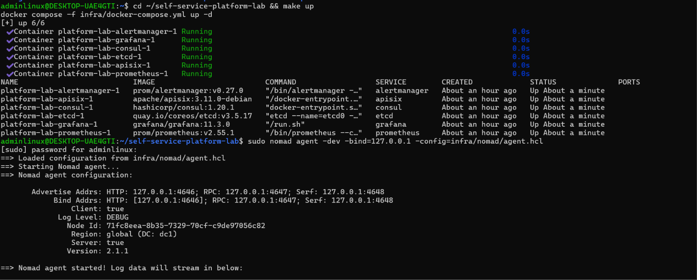

## 03-validate-guardrails

## 04-rendered-job

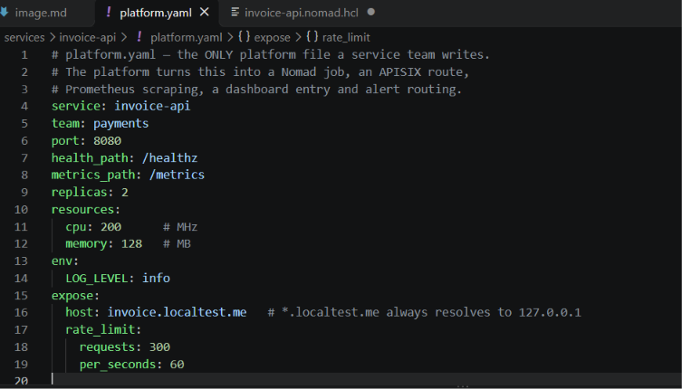

## 05-deploy-terminal

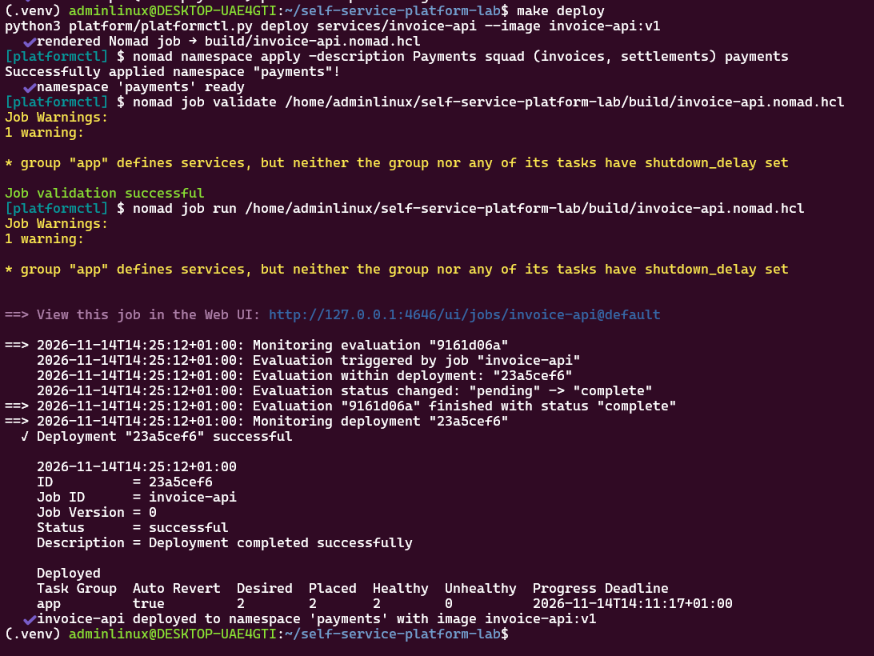

## 06-nomad-ui-job

## 07-consul-ui-service

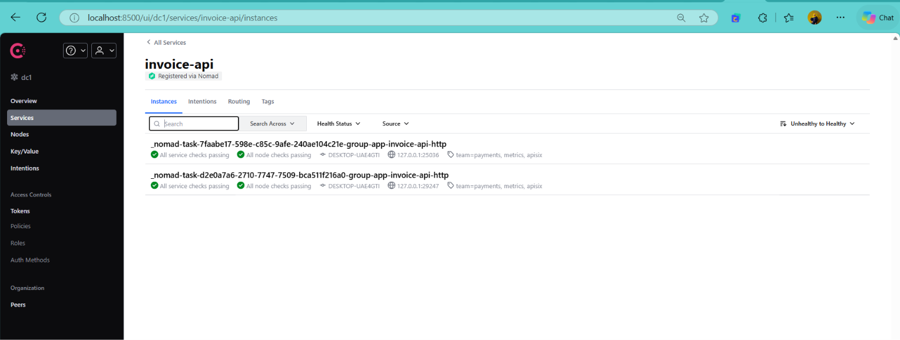

## 08-expose-and-curl

## 09-browser-service

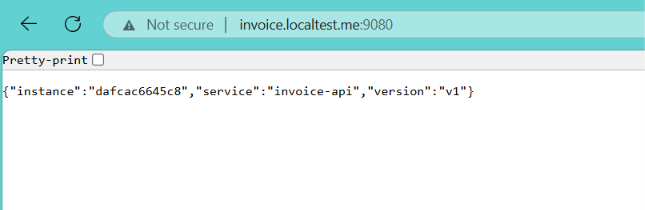

## 10-rate-limit

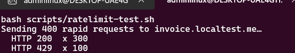

## 11-prometheus-targets

## 12-grafana-dashboard

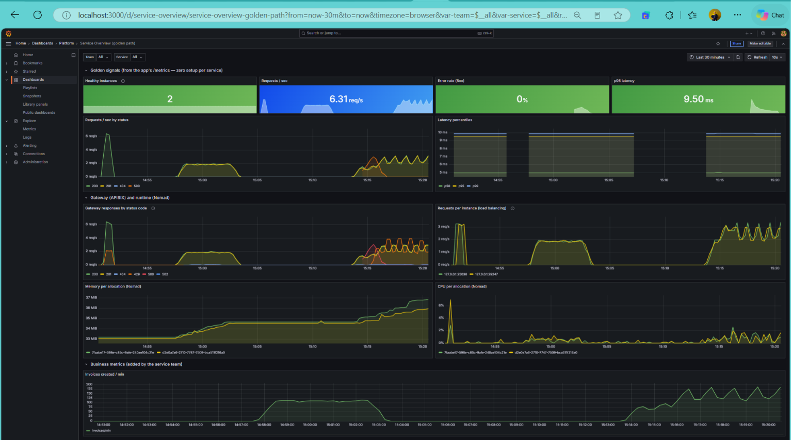

## 13-alert-firing

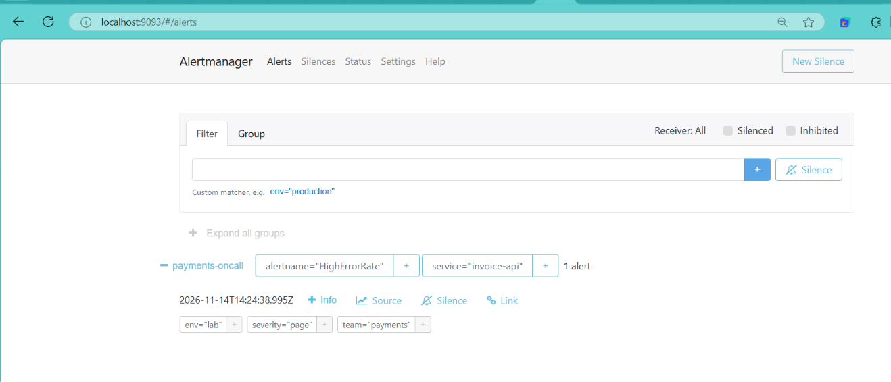

## 14-grafana-incident

## 15-bad-release-revert

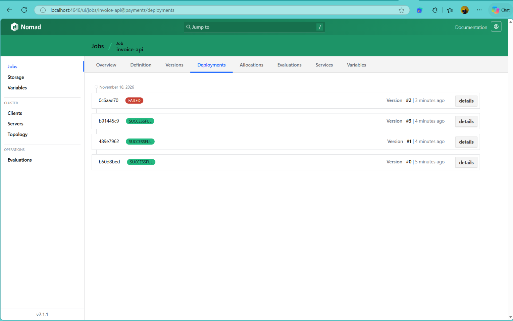

## 16-scale-to

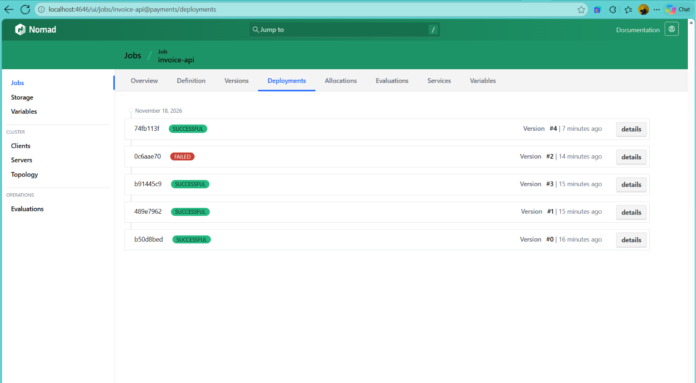

## 16-scale-to-3

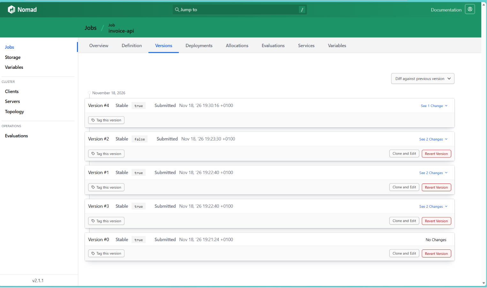

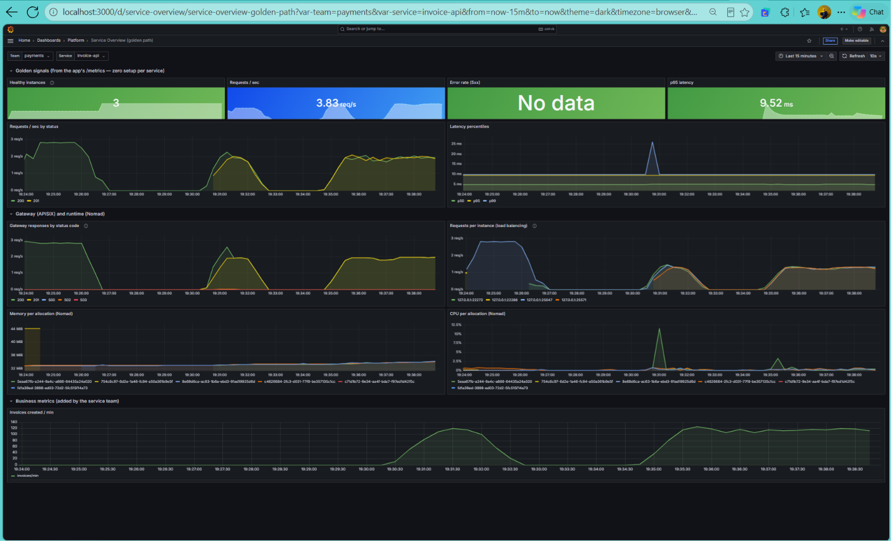

## 17-github-actions-run

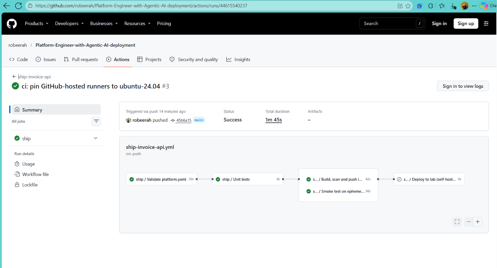

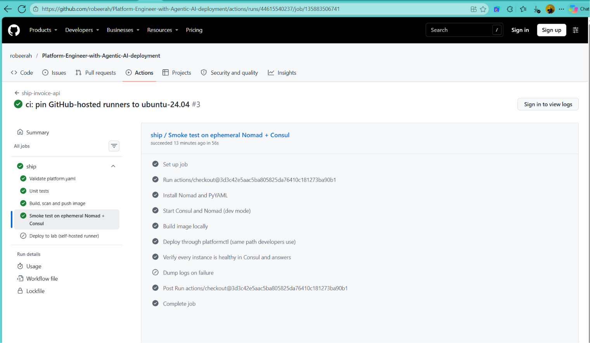

## 18-ghcr-package

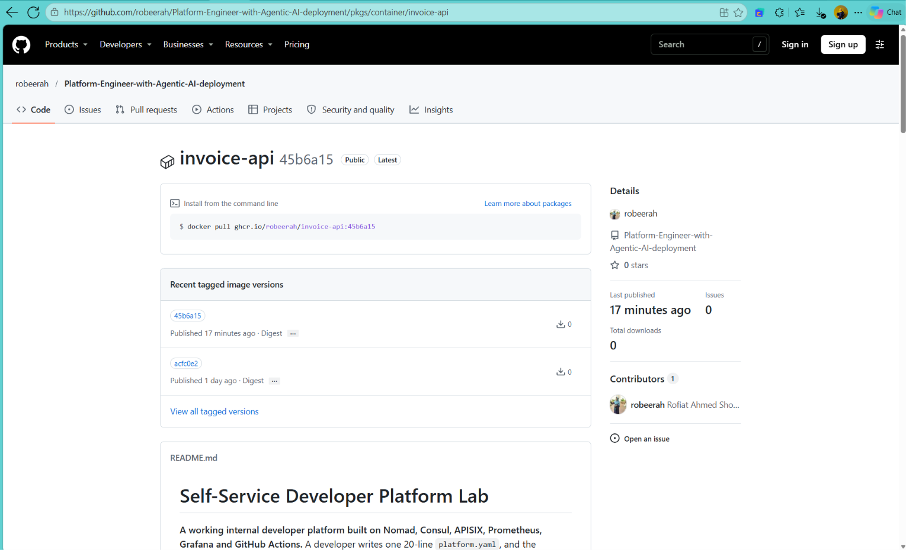

## 19-pr-guardrail

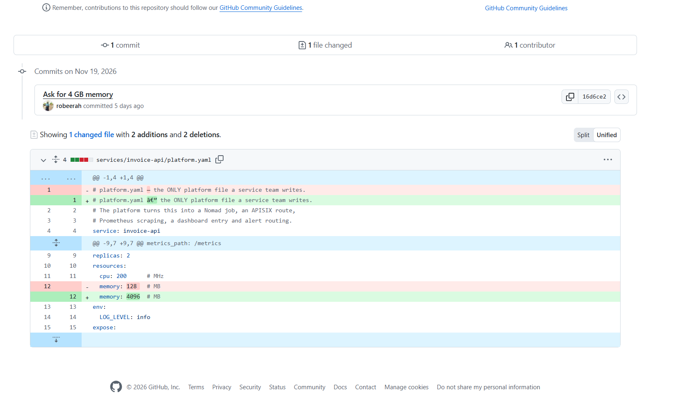

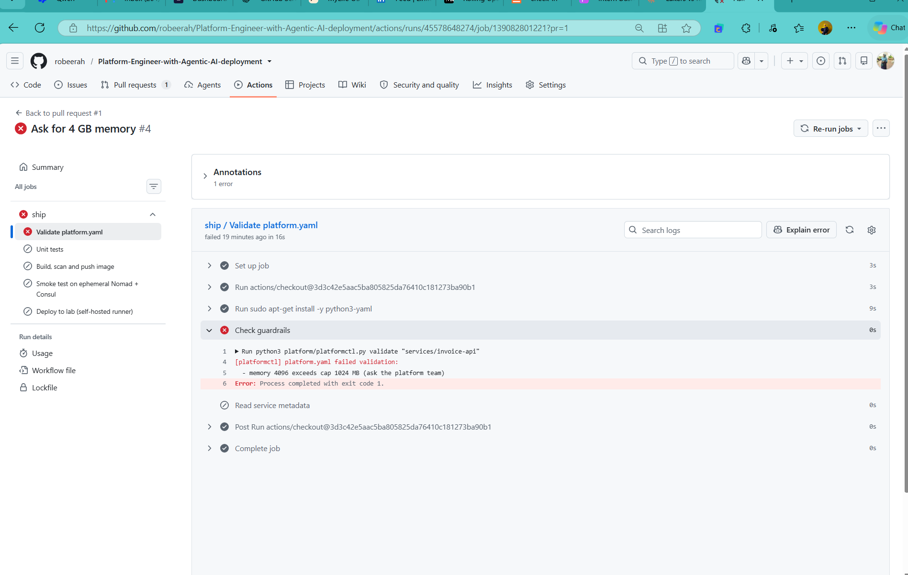

